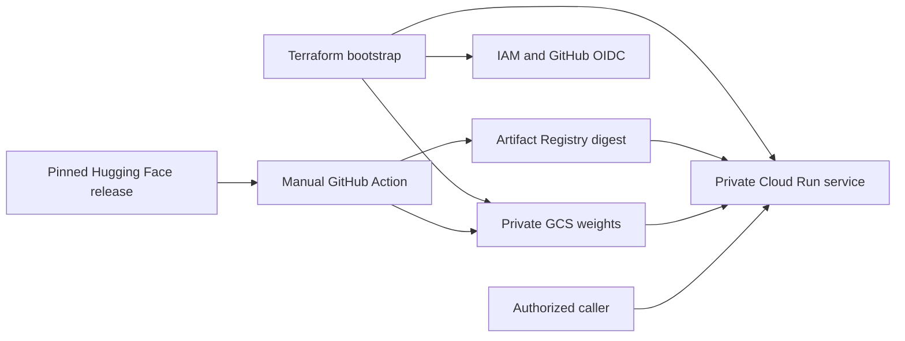

# Clef on Cloud Run

Self-host Cloudflare's Clef decision models behind Google Cloud IAM, with
Terraform infrastructure and a manual GitHub Actions deployment. Choose the
27B `clef` model or the 9B `clef-flash` model per service. Each service scales
to zero and downloads its pinned files from private regional GCS when it starts.
This is a bounded text and image adapter for `/v1/systemone`.

| Model | Cloud Run GPU | Instance shape | Pinned weights |
|---|---|---|---:|
| `clef` | RTX PRO 6000 (96 GB) | 20 vCPU / 80 GiB | 55 GB |
| `clef-flash` | L4 (24 GB), intended shape | 8 vCPU / 32 GiB | 19 GB |

The original 27B deployment was exercised on an RTX PRO 6000 in `us-central1`,
including bounded PNG/JPEG requests and negative input tests. See
[validation and measurements](docs/VALIDATION.md) for the exact evidence boundary
for each model and deployment path.
Flash has executed successfully on the RTX PRO 6000. Its rendered L4 shape has
not yet been exercised because the test deployment's L4 quota was denied.
The [bounded benchmark](benchmarks/README.md) separates those measured results
from the fully synthetic public fixtures available for future runs.
For the complete Flash bootstrap, weight upload, GPU deployment and shutdown
path, use the [Flash playbook](docs/FLASH.md) and its
[Terraform example](infra/terraform.flash.tfvars.example). An explicit
`rtx-pro-6000` GPU profile matches the hardware used for Flash validation;
`model-default` retains the intended L4 shape.

## What you get

- IAM required, an explicit invoker list, and public access prevention on GCS.
- Minimum instances **0**, maximum **1**. GPU zonal redundancy is disabled for
  `clef` and enabled for the intended `clef-flash` L4 shape. The explicit RTX
  profile disables GPU zonal redundancy and uses 20 vCPU / 80 GiB.
- A model-specific GPU shape: RTX PRO 6000 with **20 vCPU / 80 GiB RAM** for
  `clef`, or L4 with **8 vCPU / 32 GiB RAM** for `clef-flash`.
- HTTP concurrency **8**, with at most **two** simultaneous model calls.
- Accelerated FLA and causal-conv1d kernels, with actual kernel-call counters.
- Pinned model revision, file sizes, SHA-256 checksums, and immutable image releases.
- Read-only runtime access to weights. GitHub authentication uses OIDC, without
  service-account keys, restricted to your repository IDs, main branch, and workflow.
- CPU-only bootstrap and CI. A changed GPU deployment incurs startup costs;
  neither CI nor the deployment workflow sends inference requests.
- Bounded inline PNG/JPEG image support without fetching caller-provided URLs.



## 1. Prepare a repository and project

Put the contents of this directory at the **root of a new GitHub repository**
whose default branch is `main`. Include `.github/` and keep the filename
`.github/workflows/deploy.yaml`: the OIDC restriction includes that path.
Publish this extraction, not the original infrastructure repository or its history.

Use an existing billing-enabled Google Cloud project. Confirm
[GPU availability and quota](https://docs.cloud.google.com/run/docs/configuring/services/gpu)
for the RTX PRO 6000 (`clef`) or L4 (`clef-flash`) in your selected region first.
The causal-conv1d wheel targets both Blackwell `sm_120` and Ada `sm_89`.

Install Terraform >=1.5, Python >=3.12, Google Cloud CLI, and GitHub CLI. Run the
commands below from the new repository root in Linux, macOS, or WSL. The bootstrap
operator needs permission to enable APIs and manage project IAM/custom roles,
service accounts/WIF, buckets, Artifact Registry, networks, and Cloud Run services.
The GitHub deployer receives narrower permissions from Terraform, including
permission to invoke this service and to publish new runtime code.

```bash
gcloud auth login
gcloud auth application-default login
gh auth login
gh api repos/OWNER/REPOSITORY --jq '{repository_id: .id, owner_id: .owner.id}'
cp infra/terraform.tfvars.example infra/terraform.tfvars
```

Edit `infra/terraform.tfvars` with your project ID, GitHub repository and numeric
IDs, and invoker identity such as `user:you@example.com`. Set `model_variant` to
`clef` or `clef-flash`. Keep `service_name` aligned with the deployment you mean
to operate (for example, `clef-flash` for a separate Flash service). The IDs prevent
a renamed or re-created GitHub name from inheriting deployment access. Keep
`gpu_profile = "model-default"` for the model's intended shape, or explicitly
select `"rtx-pro-6000"` for the hardware used in the Flash tests. Keep
`terraform.tfvars` and Terraform state private; they are ignored by Git. Defaults
are service and model `clef` in region `us-central1`. Protect `main` and review
workflow changes.

## 2. Bootstrap infrastructure once

```bash
terraform -chdir=infra init
terraform -chdir=infra plan -out=bootstrap.tfplan
terraform -chdir=infra apply bootstrap.tfplan
python3 scripts/configure_github.py OWNER/REPOSITORY
```

Review the plan before applying. It creates storage, IAM, a Direct VPC subnet,
Artifact Registry, and a small **private CPU hello service**. It does not start
the Clef GPU model. Back up the local state securely; the workflow does not own or
modify it. Teams can configure a private Terraform remote backend separately.
IAM propagation can take several minutes before the first GitHub run.

Terraform owns infrastructure and the service-level IAM/scaling policy. It ignores
the runtime template after creation, so subsequent applies do not revert the GPU
release to the hello image. GitHub Actions owns that template and validates it
after deployment. Project/organization IAM is inherited: use a dedicated project
or review those policies too. The deployer is a trusted code publisher and can
change the runtime code; the restricted runtime identity is not a sandbox against
a compromised deployment identity.

## 3. Deploy manually

```bash
gh workflow run deploy.yaml --ref main --repo OWNER/REPOSITORY
```

Follow the run in GitHub Actions. Terraform's `CLEF_MODEL` repository variable
selects the model; a workflow `model` input can override it for that run. The
workflow downloads each pinned Hugging Face file, verifies SHA-256, uploads to
GCS, and releases the temporary file. It needs space for the largest shard, not
all 19 GB (Flash) or 55 GB (27B) at once. Existing matching objects are reused;
mismatched objects fail closed. The model's LICENSE is among the files.

The GitHub-hosted runner builds the CUDA extension separately, frees its compiler
cache, then builds and pushes the slim runtime image. Build cleanup is confined
to this disposable runner. Allow tens of minutes for the first upload/build; do
not use Cloud Shell's small home directory for the full model. The deployment
action releases an immutable image digest. Startup downloads the selected model
into instance memory, checks it, then loads GPU tensors. Startup probes allow 15 minutes.

Rerunning the **same commit** reuses its existing image. An identical image digest
and runtime configuration skips deployment. To reuse an image after documentation
changes, supply its full digest explicitly:

```bash
gh workflow run deploy.yaml --ref main --repo OWNER/REPOSITORY \
  -f image_digest=us-central1-docker.pkg.dev/YOUR_PROJECT/clef/api@sha256:YOUR_DIGEST
```

This must point to this starter's own registry/repository. A new commit without a
prebuilt image can rebuild even if it changes only documentation. The build pins
direct dependencies and model files; mutable base tags, apt packages, and
transitive dependencies mean it is not a byte-for-byte reproducible build.

## 4. Verify, then send one test request

```bash
export PROJECT=your-project-id
export REGION=us-central1
export SERVICE=clef
export MODEL=clef
python3 scripts/verify.py
# Explicit paid request: a cold instance takes several minutes.
python3 scripts/smoke_test.py --allow-paid-request
# To send a local PNG/JPEG with one paid request instead:
python3 -m venv .venv
.venv/bin/pip install pillow==13.0.0
.venv/bin/python scripts/smoke_test.py --allow-paid-request --image /path/to/small-image.png
```

`verify.py` reads service IAM/scaling and recent instance metrics without invoking
the API. It needs Monitoring read access; samples are delayed, and absence of
samples does not prove zero. Check active and idle states across revisions.
`smoke_test.py` sends exactly one authenticated request, with no retries. Your
logged-in user must be in `invoker_members` or otherwise have inherited invoker
access. Automation should use an identity token with the service URL as audience.
`--image` embeds the local file as a base64 data URL. Use a 16–512 pixel PNG
or JPEG no larger than 48 KiB; the full JSON request must fit within 64 KiB.

The API URL is `$(terraform -chdir=infra output -raw service_url)/v1/systemone`.
A request body looks like this:

```json
{
  "model": "clef",
  "state": "Our checkout is down and orders are blocked.",
  "questions": {
    "team": {
      "type": "choice",
      "criteria": {"billing": "Invoices and payments", "technical": "Bugs and outages"}
    },
    "outage": {"type": "noul", "instructions": "Is a service down?"}
  }
}
```

Use the deployed variant's name in `model` (`clef` or `clef-flash`). It returns
typed answers/probabilities, not generated chat text. This wrapper
accepts JSON up to 64 KiB, with 16 questions and 32 criteria per question.
It accepts one or two inline PNG/JPEG images encoded as base64 data URLs, each
16–512 pixels per side and at most 48 KiB decoded. It rejects external image URLs,
file paths, videos and caller-supplied media overrides. Even two images must fit
in the overall 64 KiB request body.
The wrapper checks the full encoded input and rejects requests exceeding the
2,048-token model context with HTTP 400. General chat APIs, sustained load, and
maximum-size concurrent requests and general-image accuracy have not been
validated here.

## Cost and stopping a test batch

At the `us-central1` list prices checked on **2026-10-20**, the 27B shape costs
approximately **$3.19/hour, or $0.053/minute per running instance**, including GPU,
CPU and RAM, without zonal redundancy. The intended Flash L4 shape calculates
to approximately **$1.80/hour, or $0.030/minute** with its configured zonal
redundancy, or **$1.42/hour** without redundancy. L4 execution and its bill have
not been measured; the reported Flash benchmarks used the same RTX shape as
27B. Startup and idle time are billed.
Regional GCS model storage, image storage, GitHub Actions, networking, taxes and
discounts are separate. [Pricing](https://cloud.google.com/run/pricing) can change.

`min=0` enables automatic scale-to-zero. It does not make idle time immediately
free: Google documents idle GPU retention of up to ten minutes. There is no
idle-timeout setting in this recipe. `max=1` limits ordinary scaling but is not
a hard spending cap; temporary additional instances can occur during replacement
or traffic events. Budget alerts are notifications, not a kill switch.
[Autoscaling behavior](https://docs.cloud.google.com/run/docs/about-instance-autoscaling).

For a completed test batch you can explicitly stop the service:

```bash
python3 scripts/set_scaling.py 0     # Disables the API; allows in-flight work to finish.
python3 scripts/verify.py --paused  # Checks MANUAL zero, IAM and delayed instance samples.
# Check Cloud Run instance metrics until shutdown completes.
python3 scripts/set_scaling.py auto  # Restore request-driven min=0/max=1.
```

Do not immediately resume and assume shutdown completed. These mode changes do
not create a new revision, but manual zero makes the API unavailable until
restored. Do not call health/inference endpoints periodically to monitor this
service: authenticated calls can wake or keep the GPU instance alive.
[Manual scaling](https://docs.cloud.google.com/run/docs/configuring/services/manual-scaling).

For permanent removal, pause first and review `terraform -chdir=infra plan -destroy`.
The nonempty model bucket intentionally cannot be destroyed automatically
(`force_destroy=false`); empty it explicitly only after deciding to discard those
weights. Artifact Registry deletion removes its images. Preserve state until
resource removal is complete. Neither action should be used as an automated test.

## Local checks and attribution

```bash
python3 -m venv .venv
.venv/bin/pip install pillow==13.0.0 fastapi==0.135.1 uvicorn==0.42.0 google-cloud-storage==3.16.0
.venv/bin/python -m compileall -q runtime scripts
.venv/bin/python -m unittest discover -s runtime -p 'test_*.py'
.venv/bin/python -m unittest discover -s benchmarks -p 'test_*.py'
.venv/bin/python scripts/check_adapter.py
terraform -chdir=infra fmt -check
terraform -chdir=infra init -backend=false
terraform -chdir=infra validate
```

These checks do not deploy or run inference. The independent CI workflow runs
them without cloud credentials. Model/dependency upgrades need a separate GPU
validation because import checks alone cannot prove CUDA execution.

See [third-party notices](THIRD_PARTY.md), [validation](docs/VALIDATION.md), and
[benchmarks](benchmarks/README.md). This is a community recipe, not an official
Cloudflare or Google release.
